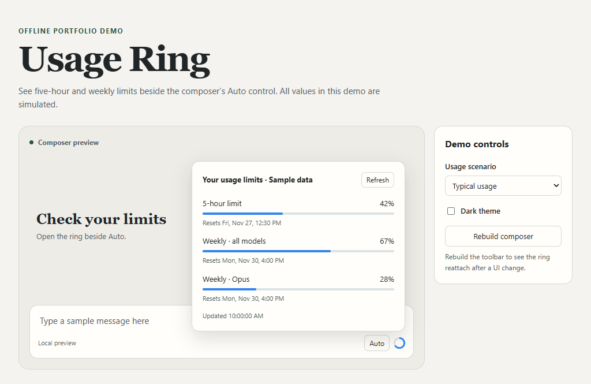

# Usage Ring for Claude Desktop

An independent Windows engineering case study and interactive browser demo. The original proof of concept placed a small usage ring beside **Auto** in the Claude Desktop composer. Open it to see the five-hour allowance, weekly limits, and reset times at a glance.

[Try the interactive demo](https://souravc1209-star.github.io/claude-desktop-usage-ring/demo/) · [Run locally](docs/installation.md) · [Read the technical case study](docs/case-study.md)

## Try it

1. Open the ring beside **Auto**. Its color and fill reflect the higher of the five-hour and all-model weekly percentages.
2. Switch the usage scenario to see a near-limit state, a reset, partial data, a service error, or a timeout. Choose **Refresh** in the panel to repeat the current scenario.
3. Switch to **Dark theme** or choose **Rebuild composer** to see the ring reattach when the toolbar is replaced. Any text in the sample composer stays in the browser tab.

[Watch the demonstration GIF](media/demo.gif) · [View the dark-theme screenshot](media/near-limit-dark.png)

## Prototype and public demo

The working Windows prototype used a PowerShell launcher, Windows UI Automation, native keyboard events, and a Chromium DevTools Snippet. The snippet read account usage through an undocumented, signed-in Claude interface. The launcher operated at the window level and the snippet rendered the indicator in the current composer. That integration depended on an unsupported interface, window titles, focus, shortcut behavior, and the current composer DOM.

This repository contains a standalone recreation of the widget and a local simulator. It runs in an ordinary browser with synthetic data. It includes no Claude credentials, signed-in requests, or desktop automation. For actual account figures, use **Settings → Usage** in Claude. [Claude Help Center](https://support.claude.com/en/articles/11647753-how-do-usage-and-length-limits-work)

| Location | Contents |
| --- | --- |
| [`src/`](src/) | Ring, panel, rendering, refresh, and DOM lifecycle |
| [`demo/`](demo/) | Sample composer, theme controls, and simulated usage provider |
| [`tests/`](tests/) | Browser smoke test and capture mode |
| [`docs/`](docs/) | Setup, troubleshooting, case study, and publication review |
| [`media/`](media/) | Screenshots and GIF captured from the offline demo |

[Troubleshooting](docs/troubleshooting.md) · [Validation and privacy review](docs/review.md) · [Changelog](CHANGELOG.md)

The project was developed with AI assistance. The project owner built and exercised the original prototype. AI assistance was used in developing the prototype and in preparing the offline edition, tests, and documentation. This project is unaffiliated with Anthropic. The name Claude Desktop identifies the application studied and the demo uses original artwork and interface styling. The [MIT License](LICENSE) applies to the project’s original materials.
