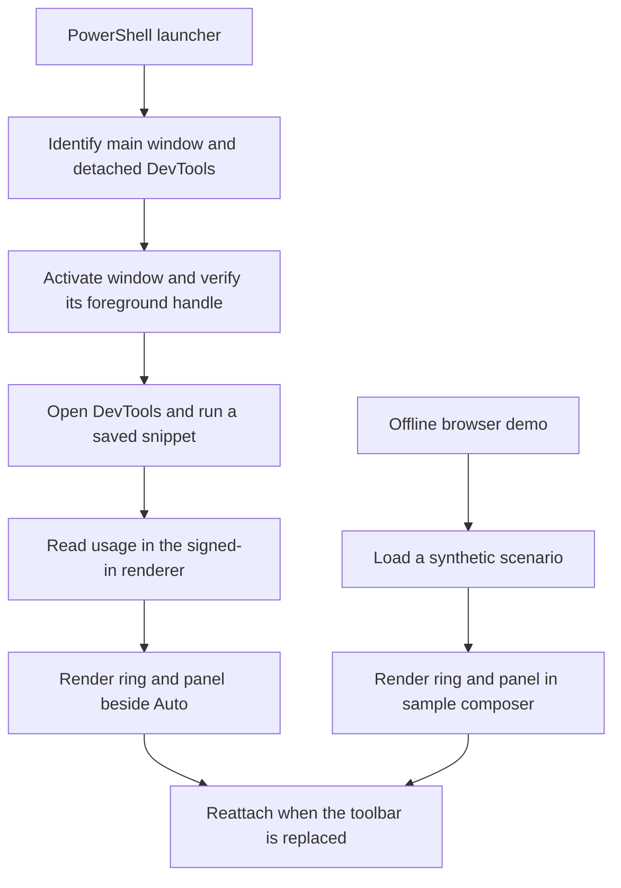

# Engineering the Usage Ring

## Problem

Checking Claude’s usage screen interrupted the task of writing a message. The Windows proof of concept kept the relevant numbers near the composer. One small indicator represented the more depleted of the two primary limits. Opening it showed each limit, its progress bar, and its next reset. The prototype used facilities already available on the machine, including PowerShell, Windows UI Automation, native keyboard input, and Chromium DevTools.

The composer’s Auto toolbar had enough room for a compact indicator without adding a separate settings surface. The recovered V3 snippet locates that toolbar and attaches the widget in the active web renderer. A DevTools Snippet offered local, reversible JavaScript customization while leaving the application executable alone. Its page changes live in a renderer session. Restarting or fully reloading the renderer requires running the snippet again, which motivated the launcher.

## Architecture

The first path describes the original Windows prototype. The second path is the executable code in this repository. The public loader resolves a synthetic usage object, rejects to simulate an outage, or waits long enough to time out. The widget normalizes that result into rows and derives its ring from the highest valid primary percentage. The same renderer accepts a different set of categories or thresholds with another authorized provider. [Widget interface and example](widget.md)

## Identifying the right window

Early launcher snapshots looked up the Claude process and used its main-window handle. The project owner observed that the main window and detached DevTools could share a process ID, making process-level identification insufficient. The surviving snapshots show the change from process lookup to enumerating direct UI Automation children, but they do not record the historical PID values. The launcher checked each window’s process against the installed executable pattern, then used separate title predicates and individual native handles for the app and its Claude-targeted DevTools. Polling had a bounded timeout and stopped when more than one window matched. Changes to the package name, titles, localization, or docking behavior could invalidate these assumptions. [Microsoft Learn on obtaining UI Automation elements](https://learn.microsoft.com/en-us/windows/win32/winauto/uiauto-obtainingelements)

## Foreground activation and keyboard input

Finding a window and directing keyboard input to it are separate operations. The launcher asked Windows to restore the window and bring it forward, then compared `GetForegroundWindow` with the intended native handle. It used `WScript.Shell.AppActivate` as a fallback and checked the handle again. The snippet command sequence checked the foreground window before each group of keystrokes. Focus can still change between a check and the next key event, and a foreground-handle match says nothing about which control inside the window has focus. [Microsoft Learn on foreground activation](https://learn.microsoft.com/en-us/windows/win32/api/winuser/nf-winuser-setforegroundwindow)

The later launcher revision used the native Windows keyboard API for the DevTools shortcut. It pressed left Ctrl, left Alt, and I in order, then released the keys in reverse order. After the detached DevTools window appeared, it still used `WScript.Shell.SendKeys` for snippet search, selection, and closing the tools window. A completed key sequence could confirm that the launcher got through that stage. Verification of JavaScript execution came from seeing the ring in the composer. The prototype used `keybd_event`, which Microsoft has superseded with `SendInput`. [Microsoft Learn on keybd_event](https://learn.microsoft.com/en-us/windows/win32/api/winuser/nf-winuser-keybd_event) · [Chrome DevTools on running snippets](https://developer.chrome.com/docs/devtools/javascript/snippets)

The local launcher log separated discovery, focus, and key dispatch. This narrows failures to a stage. A log entry that records a sent key cannot prove that the expected DevTools control handled it. The owner verified activation by observing the ring in the intended composer. The launcher depends on an unlocked, interactive Windows desktop in a compatible focus state.

## Cold starts and readiness

The main app window could appear before the renderer was ready to respond to its shortcut. The launcher reused a matching main window if it already existed. When the DevTools window was absent, the final revision waited ten seconds, verified focus again, sent the shortcut, and polled for the detached tools window. It then allowed short pauses between the DevTools actions. The waits were tuned against the original setup. Fixed delays can be too short on a slower machine and add latency on a faster one. The public demo uses deferred scripts and renders a loading state while the simulator is pending.

## Keeping the indicator attached

The toolbar can be replaced when the host UI is rebuilt. Both versions locate a visible toolbar by a class token and append one ring. The original snippet used a debounced `MutationObserver`. The demo coalesces external mutations into one animation frame and skips records inside the widget. It attaches the same button and panel to the replacement toolbar and closes the panel when its anchor moves. The simulator preserves the draft across the rebuild. **Rebuild composer** reproduces this without navigating away from the demo.

The renderer cancels pending reads and removes observers and listeners on cleanup. Remounting replaces the prior widget. A slow or superseded read cannot update a disposed or newer widget. The browser smoke test exercises both the toolbar replacement and consecutive mounts.

## Data and display reliability

The ring uses the larger finite percentage from the five-hour and all-model weekly rows. It clamps percentages to 0–100 and can display one primary row when the other is missing. An explicitly unset reset is shown as `Not started`. Missing or invalid resets appear as `Unavailable`. Optional model rows appear when a scenario supplies a numeric value.

The panel chooses the side of the ring with usable room and scrolls internally when the viewport is short. Using the document’s content width avoids positioning into the scrollbar gutter. The panel stays next to the ring in DOM order, so Tab follows the composer flow. Escape and the Close button return focus to the ring. Named progress bars expose the percentage to assistive technology, and visible percentages accompany the colors. Scenario switching cancels any outstanding read, and a timeout presents a retry.

## Distribution tradeoffs

The Windows setup made for a convincing proof of concept because it used the user’s real workflow and required no extra modification tools. It also tied the experience to foreground focus, fixed delays, app-specific selectors, and an undocumented authenticated interface. The offline release retains the composer affordance, DOM reattachment, reset formatting, and real interaction states. Synthetic data makes those behaviors reproducible without account access. Dependency-free JavaScript avoids installation and build steps for readers. Playwright and axe run only in development and CI.

## What the surviving files show

| Stage | Evidence |
| --- | --- |
| Early launcher iterations | Backup snapshots used process and main-window-handle discovery, a foreground check, and shell-synthesized input. |
| UI Automation revision | A saved launcher revision enumerated UI Automation windows and kept the foreground checks. |
| Native keyboard revision | The working launcher introduced explicit left-modifier key events and a longer wait before the shortcut. |
| V3 widget | The recovered snippet contained the composer selector, observer, cleanup, optional model rows, and usage fetch. |
| Offline edition | The source in this repository replaces the signed-in read with a simulator and adds interaction controls and browser tests. |

This timeline comes from the recovered source and backups. The public Git history begins with the offline edition. See [Validation and privacy review](review.md) for the terms review and evidence behind the public release.
